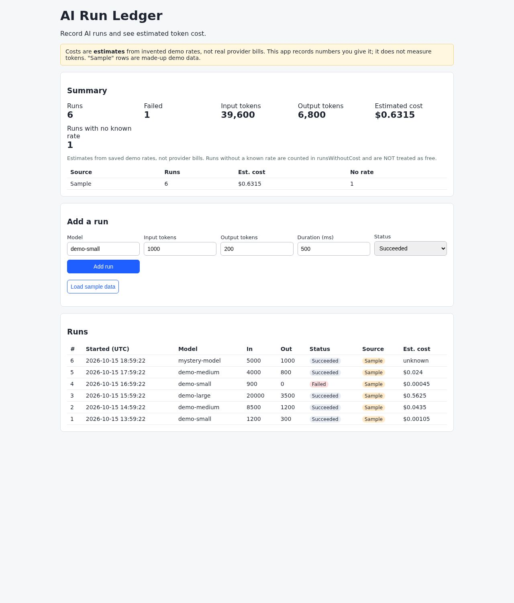

# AI Run Ledger

A small ASP.NET Core (.NET 10) app that records AI runs (model, input/output tokens, status, time, duration) and shows an **estimated** cost per run plus totals. Data is stored in SQLite.

> **Honest limits.** Costs are estimates from **invented demo rates** in `RateCard.cs`, not real provider prices or bills. The app records numbers you type in or load as sample data. It does not call any AI provider, measure tokens, or read real bills. "Sample" rows are made-up demo data and are totalled separately from "Manual" rows.

## What it does

- `POST /api/runs` - validate and save a run, estimate its cost, snapshot the rates used
- `GET /api/runs` and `GET /api/runs/{id}` - list and detail
- `GET /api/summary` - totals, failed runs, runs with no known rate, totals split by Sample / Manual
- `POST /api/samples` - load labelled sample data (once)
- A single web page at `/` to use all of the above

Design choices worth being able to explain:

- **Unknown is not zero.** A model with no saved rate gets a `null` cost. The summary counts these separately instead of treating them as free.
- **Rate snapshot.** Each run stores the rates used when it was saved, so changing the rate card later does not rewrite history.
- **Decimals in SQLite.** SQLite has no true decimal type, so EF Core stores them as text. SQL cannot `SUM` them, so summaries are calculated in C#. See the [EF Core SQLite limitations](https://learn.microsoft.com/en-us/ef/core/providers/sqlite/limitations).
- **No prompts or secrets stored.** Only counts and metadata.
- **Validation** rejects negative or absurd token counts, bad status/source, future start times.

## Run it on Windows (VS Code)

1. Install the [.NET 10 SDK](https://dotnet.microsoft.com/download/dotnet/10.0) and check with `dotnet --list-sdks`.
2. Install VS Code and the "C# Dev Kit" extension.
3. Open this folder in VS Code, then open a terminal (Terminal > New Terminal) and run:

```powershell
dotnet test
dotnet run --project src/AiRunLedger.Api
```

4. Open http://localhost:5080 . Click **Load sample data**, add a run, then stop and restart the app: your runs are still there (saved in `airunledger.db`, which is git-ignored).

To start fresh, stop the app and delete `src/AiRunLedger.Api/airunledger.db`.

## Project layout

```
src/AiRunLedger.Api/
  Domain/     RateCard, CostCalculator, validation, RunService (business rules)
  Data/       EF Core DbContext (SQLite)
  wwwroot/    the single-page UI
  Program.cs  endpoints
tests/AiRunLedger.Tests/
  CostCalculatorTests, ValidationTests, SummaryTests   (unit)
  ApiTests, PersistenceTests                            (integration, real SQLite file)
.github/workflows/ci.yml                                (build + test on push/PR)
```

## Tests

`dotnet test` runs unit tests (cost maths, validation, summary rules) and integration tests that start the real app with `WebApplicationFactory` against a temporary SQLite file, including a restart-persistence test. See [integration tests in ASP.NET Core](https://learn.microsoft.com/en-us/aspnet/core/test/integration-tests?view=aspnetcore-10.0).

## Put it on GitHub

Create an empty repository on github.com (no README), then in this folder:

```powershell
git init
git add .
git commit -m "Initial commit: AI Run Ledger"
git branch -M main
git remote add origin https://github.com/YOUR-USERNAME/ai-run-ledger.git
git push -u origin main
```

Replace YOUR-USERNAME with your GitHub username. The CI workflow then runs automatically ([.NET build and test on Actions](https://docs.github.com/en/actions/tutorials/build-and-test-code/net)).

## Demo script (2-3 minutes)

1. Show the sample-data warning banner and say what is and is not real.
2. Load samples; point out the unknown-rate row and that it is not counted as free.
3. Add a run with bad input (negative tokens) and show the validation message.
4. Add a valid run, show cost and totals.
5. Restart the app; show the data persisted.
6. Run `dotnet test`; show the green tests.

## App preview



The dashboard records supplied token usage and estimates costs using invented demo rates. Sample data is labelled; these are not real provider bills.

## Ideas for later (not built)

Real provider usage import, editable rate card, filtering by date/model, EF Core migrations. Keep them out of version one.

## Before you show this to anyone

Make sure you can explain every file and make a small change yourself (for example add a new demo model to `RateCard.cs` and a test for it). That matters more than the project itself.
